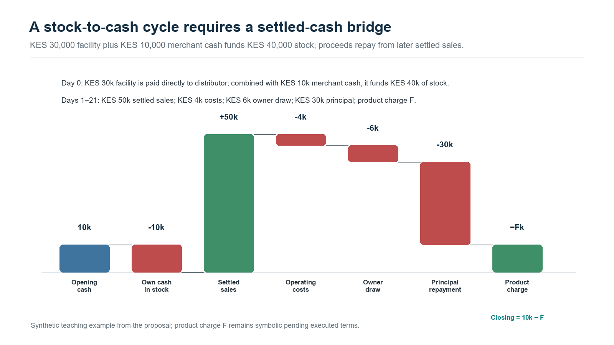
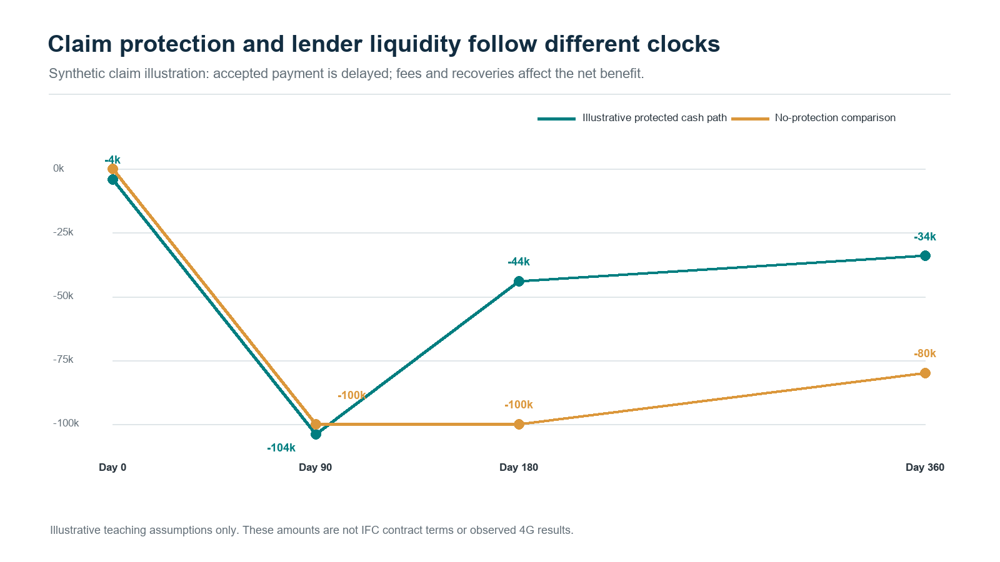

# Making each lending cycle strengthen the business: an Underwrite for Collection application for 4G Capital

**Nevil Maloba | 13 October 2026**

<!-- ARTICLE_BODY_START -->

## Start with what happens after the stock arrives

A merchant receives stock, makes sales and repays a working-capital loan. The next question is whether the business can replenish its shelves, meet its commitments and enter another trading cycle with sufficient cash. That question brings together the practical concerns behind my whitepaper, *Underwrite for Collection*: product design, evidence, underwriting, servicing, intervention, recovery and funding [1]. A recorded repayment is one event within that larger operating story. Understanding how it was produced helps the lender assess the next facility, recognise pressure earlier and identify useful support. For 4G Capital, this suggests a research partnership organised around the quality of successive business and lending cycles.

4G Capital’s published UPIA product combines unsecured, thirty-day working-capital finance with training, personal support and loyalty-based pricing [2]. KUZA describes twenty-one-day stock finance through distributor relationships, with disbursement directly to the distributor and pricing linked to business margins [3]. The company’s wider “touch-tech” approach combines digital access with personal engagement [4]. These features create a specific setting for the research: short cash-conversion cycles, repeat lending, observable purchase relationships and business support delivered alongside credit. The proposal here connects those activities into a testable framework. Its application would begin with agreed data, product definitions and operational priorities shared by the participating teams.

## Three questions for a practical research programme

**Research question one:** How can merchant receipts, stock movements, margins and essential commitments establish whether each loan supports a sustainable operating cycle? **Research question two:** Which combination of support, timing and authorised credit adjustment improves business cash, repayment and customer experience over successive cycles? **Research question three:** How can the IFC risk-sharing partnership translate into additional, sustainable lending while its underwriting, claims, liquidity and retained-risk consequences remain measurable? The first question establishes the economic evidence. The second evaluates decisions. The third connects borrower outcomes to an institutional funding and protection arrangement. Their answers would support a coherent product and portfolio strategy.

## Connect financed inventory to the next cash cycle

For a KUZA-style application, distributor payment provides an identifiable starting event. The proposed evidence chain connects the order, delivery confirmation, quantities received, expected selling period, actual sales, customer receipts and loan settlement. It also records returns, damaged stock, supplier credits and unsold inventory. The merchant’s previous relationship with a distributor can provide useful context for interpreting these events. Product assessment then asks whether the financed order fits the store’s sales capacity and stock mix. A higher purchase amount can increase the range available to customers, while its economic value depends on margins, turnover, payment timing and the remaining cash needed to keep trading.

The key liquidity calculation follows the same dates as the loan. For a defined payment window, a simple planning identity is:

Cash available for repayment = opening unrestricted cash + settled operating receipts − essential operating payments − household commitments − other obligations

All quantities use the same currency and time window. Stock purchases already included among operating payments are counted once. The merchant’s margin calculation separately records sales less the cost of goods sold; remaining inventory carries its own value and uncertainty. This distinction connects profitability to cash availability and gives an officer a way to discuss a payment date using the business’s actual operating calendar.

Consider a hypothetical merchant starting with KES 20,000 unrestricted cash and receiving KES 100,000 of financed stock. The assumed sale proceeds total KES 125,000, of which KES 90,000 arrives by day twenty-one. After KES 10,000 operating payments and KES 8,000 household commitments, cash available is KES 92,000. An illustrative KES 105,000 contractual payment creates a KES 13,000 gap; preserving a KES 10,000 operating floor requires KES 23,000. These are teaching assumptions; the stated charges belong to this illustration. The remaining KES 35,000 receipt would change the cash position when settled. The useful decision concerns payment alignment, interim liquidity and the evidence supporting that receipt. The figures use a single currency, recognise each receipt once and preserve the difference between cash shortages and losses.

*Figure 1. A separate, smaller KUZA-style illustration follows KES 30,000 of supplier finance and KES 10,000 of opening cash through stock, sales and repayment; product charge F remains symbolic.*

## Establish whose cash the evidence describes

An enterprise may use cash, several mobile-money wallets, a till and bank accounts belonging to its proprietor. Transfers among them need an economic interpretation. Underwrite for Collection develops an entity and transaction graph linking authorised accounts, businesses, facilities, orders and settlements. Each relationship records its source, effective date, verification and confidence. Customer receipts, owner contributions, borrowing, refunds and internal transfers retain distinct meanings. This lets an analyst consolidate the business while tracing an amount through several payment systems. A genuine sale to a related party can remain operating income when supported; an owner injection can strengthen liquidity with its financing character visible.

That distinction matters particularly when repeat repayment becomes a key underwriting signal. The proposed review would connect each repayment with the business activity and available liquidity that supported it. It would assess sales conversion, household withdrawals, supplier obligations and the working capital remaining afterwards. A merchant completing several cycles may have earned a higher limit, better terms or additional product options. The next decision can use that accumulated experience alongside changing stock requirements and other obligations. This produces a more informative record of progression: how the business performed, how the facility fitted its cycle and which evidence supports another lending decision.

## Use time and uncertainty to improve judgement

Short contractual tenors make timing especially important. A twenty-one-day facility might encounter slower stock sales, a payment-system delay or an unexpected household expense. Each event can move the borrower through different states: performing, temporarily late, restructured, cured, defaulted or recovered. Survival models estimate the timing of defined outcomes; competing-risk models separate events such as full settlement and default; multi-state models describe subsequent transitions. An active, immature loan retains its observed history and follow-up window. Models can therefore compare equivalent periods, account for censoring and test whether apparent cure persists across later cycles. This connects branch observations with a consistent portfolio history.

Hierarchical Bayesian modelling supplies another practical advantage: learning from businesses with different amounts of experience. Underwrite for Collection combines enterprise evidence with partially pooled sector, location, product and time effects. Mwendo Pamoja provides complementary work on liquidity features, posterior uncertainty and governed decision thresholds [5]. A new trading segment can borrow information from relevant groups while retaining differences supported by its own outcomes. The hierarchy includes the individual likelihood, group distributions and priors governing between-group variation. Reviewers receive a credible interval around the estimated risk and a predictive range for future cash. Both outputs help explain how much the evidence supports a particular limit.

A proposed limit decision can include the quantity:

q = Pr(p > pₘₐₓ ∣ D)

Here p is the defined-horizon default probability under the specified model, pₘₐₓ is an approved policy threshold, D is the evidence available at the decision, and q is the posterior probability of exceeding that threshold. The decision also considers affordability, uncertainty, customer needs and the cost of the available actions. An officer could retain the existing limit, authorise a measured increase, request targeted evidence or offer an appropriate alternative. The output supports a reasoned choice whose assumptions, authority and subsequent outcome remain available for review.

Model development also records which applicants produced observable outcomes. Historical approvals, customer acceptance and repeat borrowing determine the population represented in a repayment dataset. A proposed expansion can test its relevance through shadow scoring, permitted external evidence and carefully designed prospective learning. Reject inference would document the assumptions connecting observed borrowers to the wider applicant population, with sensitivity analysis and uncertainty carried into decisions. Validation would keep related businesses together and hold out later lending cycles. This makes the performance claim useful: management can see the customers, conditions and policy under which an estimate has been tested, and which additional evidence would support broader use.

## Evaluate business support as an intervention

4G Capital’s combination of lending and training creates an opportunity to study how support contributes to business performance. Relevant options might include stock planning, simple margin records, cash budgeting or the timing of a follow-up visit. Peer-reviewed experimental work by Campos and colleagues in Togo compared forms of business training and found that programme design materially affected enterprise outcomes [6]. That study motivates careful local evaluation of content and delivery. A proposed Kenyan programme would define its own customers, needs and outcomes, then estimate effects within that setting. The research question becomes specific enough to improve a service that teams actually deliver.

A controlled study could compare approved additional support options while maintaining the standard customer service. Eligibility, assignment, delivery and follow-up would be recorded before assessing results. Outcomes would include stock turnover, gross margin, cash after essential commitments, durable repayment, customer experience and incremental servicing cost. Baseline business conditions and lending history help explain heterogeneity. Where branches or distributors share practices, the design would consider clustering and spillovers. Observational evaluation requires explicit treatment-selection assumptions and appropriate handling of time-varying confounding [7]. This gives the institution evidence about which support improves outcomes, for whom and at what resource cost.

As evidence develops, a contextual bandit could help select among approved support options using current business circumstances. Its audit record would preserve action probabilities, decision context, outcomes and policy versions. Sequential methods become relevant when one intervention changes the next trading cycle, available credit or later need for support. Human approval would govern material contractual actions within the agreed policy. The immediate practical objective is a reliable feedback loop from delivered support to business and collection outcomes. Model complexity can then follow demonstrated value, operational readiness and the precision needed for the decision, making each stage useful to branch staff and management.

## Why the IFC partnership sharpens the proposition

On 4 August 2026, IFC announced Catalytic First Loss Guarantee transactions involving 4G Capital, Equity Bank Kenya and KCB Bank Kenya. The announcement places the initiative within IFC’s MSME Platform and blended-finance support [8]. For 4G Capital, the relevant analysis begins with its individual project disclosure and executed agreement. Project 53511 describes an unfunded risk-sharing facility for a new Kenyan-shilling-equivalent MSME portfolio, including microenterprises and women-owned businesses. It also identifies advisory support for onboarding, underwriting methodology and distributor finance [9]. This creates a particularly close connection to the proposed research across product design, evidence, lending decisions, monitoring and financial protection.

The disclosure’s narrative describes a portfolio of approximately US$44.4 million equivalent and maximum IFC risk of US$6.2 million, comprising first-loss and second-loss participation. Its indicative Board table lists US$8.2 million. Implementation would reconcile those disclosure fields with the dated, executed agreement [9]. The working model would then load the confirmed eligible portfolio, attachment, sharing rules, caps, fees, dates and reporting duties. That process turns a public financing announcement into an operational specification. The project team can identify the exact exposures covered and reproduce the amount, timing and ownership of every potential claim from the agreement’s terms.

## Model protection through its entire cash process

A useful protection ledger begins when an eligible loan enters the covered population. It follows outstanding principal, arrears, recoveries and any event establishing a claim. Subsequent states include notification, document completion, acceptance, recognised receivable and settled cash. Each state has an amount, date, evidence owner and destination account. The lender can therefore assess both ultimate risk sharing and the liquidity required while a claim progresses. Short merchant loans can still produce a longer protection and recovery cycle. Portfolio management benefits from seeing those clocks together, particularly when repeated lending continues while earlier claims await settlement.

For illustration, a simplified loss-layer calculation is:

Illustrative claim = min(cap, share × max(eligible loss − attachment, 0))

The cap is the maximum claim amount, share is the covered fraction, and attachment is the loss borne before the illustrated cover begins. An actual agreement may require several layers, exclusions, cumulative limits and recovery adjustments. Each would receive its own calculation. The model records gross loss, contractual claim, settled protection and retained loss separately. Fees, administration and the funding cost of claim delay then enter the economic assessment. This provides a transparent route from contractual protection to the contribution retained by the lender.

Recovery sharing deserves its own transaction record. Cash collected after a guarantee payment may belong partly to the guarantor under subrogation or sharing terms. The ledger should allocate recoveries, collection costs and any repayment of protection in the correct order. It should also track expiry, eligible origination periods, concentration and unused capacity. A claim linked to an incomplete delivery record or inconsistent borrower identifier creates a practical reason to improve evidence at origination. Underwrite for Collection connects those records across the facility’s life, allowing the lending team to prepare a complete claim from evidence already maintained for sound servicing.

*Figure 2. Illustrative guarantee fee, loss, claim and recovery timing; values are teaching assumptions.*

## Measure additionality alongside portfolio economics

The programme creates an important evaluation question: which viable businesses receive finance, suitable limits or improved terms because risk sharing and advisory support are available? International guarantee principles emphasise clear eligibility, sound governance, efficient claims and systematic evaluation [10]. For this application, a comparison design would examine similar eligible businesses and distinguish changes in credit access from changes in business outcomes. Measurements could include first access, approval, limits, total cost, product fit, stock investment, profits and resilience through subsequent cycles. The design would record programme entry and policy changes so that observed improvements can be connected to specific decisions and mechanisms.

The same analysis should report the lender’s retained economics. Customer receipts fund servicing, expected losses, funding costs and a return on the capital supporting the exposure. Protection can change retained loss and its uncertainty, while advisory improvements can change the underlying portfolio. Their contributions should be measured separately. Gross performance remains visible alongside covered performance, allowing management to assess underwriting quality, guarantee utilisation and commercial sustainability. The funding forecast then distinguishes borrower cash, recoveries, accepted claims and settled guarantee payments. Finance would apply the relevant accounting and prudential recognition requirements to the actual entity and instrument, alongside the model’s management analysis.

## Make the advisory connection operational

The IFC disclosure’s underwriting and distributor-finance advisory priorities suggest a practical set of deliverables [9]. A shared data dictionary would define borrower, facility, order, delivery, sale, receipt and intervention. A distributor integration specification would document payment and delivery reconciliation. An underwriting review would test product horizons, repeat-loan policies and evidence quality. An experiment protocol would evaluate approved support. The project’s environmental and social management requirements would connect eligibility, relevant screening, staff responsibilities and reporting [9]. These deliverables fit a single operating programme because the merchant, product and subsequent cash appear consistently across each workstream.

Customer protection and institutional integrity also enter that programme. Borrower identification, proportionate due diligence, transaction controls and escalation support the applicable anti-money-laundering requirements. Environmental and social records should follow the project’s agreed management system and reporting scope. Complaint and grievance routes need an identifiable owner, response history and evidence of resolution. Research can examine whether customers understand terms, receive useful support and can challenge an error. Those measures give customer teams and management an additional view of product quality. They also make it possible to analyse whether a commercially promising intervention produces outcomes that remain acceptable across different customer groups.

## Keep privacy and decision responsibility explicit

For Kenyan customer data, the Data Protection Act supplies requirements covering processing principles, lawful purposes, information rights, impact assessment, security and automated decisions [11]. The General Regulations develop the operational treatment of automated individual decision-making and related safeguards [12]. An implementation would document permitted purposes, retention, role-based access, processing agreements and transfer arrangements. Identifiable merchant records would remain in the lender’s approved environment, with pseudonymised research extracts where appropriate. Customer communications would explain the relevant evidence and review routes. The legal applicability register would use the lender’s current authorisation, product and jurisdiction when translating these duties into operating controls.

Each recommendation would carry a versioned evidence packet: the business and facility identifiers, decision date, source freshness, feature definitions, posterior outputs, available actions and responsible reviewer. A correlation identifier connects the workflow, while individual event identifiers and timestamps preserve what actually happened. Maker–checker approvals govern specified changes, and execution receipts confirm the resulting action. CRM records communication and complaints; product subledgers record obligations and allocation; the general ledger receives reconciled postings. This gives an independent reviewer a reproducible route from an observed business condition to a decision, its approval, the customer’s response and the eventual financial outcome.

## Distinguish merchant finance from receivables funding

Financing a merchant’s business assesses how inventory, sales, expenses and obligations generate repayment. A separate funding arrangement may identify eligible lender receivables and dedicate their collections to investors. That second proposition requires documented rights, transferability, concentration limits, servicing continuity and account control. An SPV is one possible implementation of ring-fenced receivables financing. Its own model would follow purchases, reserves, expenses, debt service and residual distributions. Any guarantee benefit entering that structure would follow its actual beneficiary and transfer terms. The same merchant evidence can inform both analyses while each financing relationship retains its own rights and cash ledger.

## Begin with a connected pilot

A focused first project would select one product, a defined branch or distributor cohort and one repeat-lending or support decision. The team would reconcile historical orders, receipts, loan records and field observations, then establish baseline cash and lifecycle measures. Shadow recommendations would test explanations and operational fit. A controlled intervention stage would measure customer and lender outcomes with agreed precision and follow-up. In parallel, a protection module would reproduce the executed guarantee terms and stress settlement delays, recoveries and concentration. The final evidence pack would connect product performance, advisory improvements, guarantee additionality and retained economics, giving management a clear basis for its next investment.

The proposition for 4G Capital is therefore a practical one: examine whether each lending cycle leaves the merchant better able to operate and repay, identify the support that improves that outcome, and connect the evidence to institutional risk sharing and funding. Underwrite for Collection provides the main research architecture. Mwendo Pamoja contributes complementary methods for uncertainty, decision thresholds and financial reconciliation. Together, they offer a structured way to turn a short loan into a longer learning relationship with the business. A partnership can begin with one decision and expand as the evidence demonstrates value for merchants, frontline teams, the lender and its funding partners.

<!-- ARTICLE_BODY_END -->

## References

[1] N. Maloba, *Underwrite for Collection: MSME Credit Lifecycle Whitepaper*, 2026, doi: 10.5281/zenodo.23343888. [Online]. Available: https://doi.org/10.5281/zenodo.23343888 . Reproducible cases: https://github.com/TheAlchemistNerd/underwrite-for-collection/tree/main/research_lab

[2] 4G Capital, “UPIA: 30-Day Working Capital Business Loans.” Accessed: Oct. 13, 2026. [Online]. Available: https://www.4g-capital.com/upia

[3] 4G Capital, “KUZA: Embedded Retail Credit for Distributors.” Accessed: Oct. 13, 2026. [Online]. Available: https://www.4g-capital.com/kuza

[4] 4G Capital, “Financial Services for MSMEs in Kenya & Uganda.” Accessed: Oct. 13, 2026. [Online]. Available: https://www.4g-capital.com/

[5] N. Maloba, *Mwendo Pamoja: Continuous Underwriting*, research manuscripts, 2026. [Online]. Available: https://github.com/TheAlchemistNerd/mwendo-pamoja-continuous-underwriting

[6] F. Campos, M. Frese, M. Goldstein, L. Iacovone, H. Johnson, D. McKenzie, and M. Mensmann, “Teaching personal initiative beats traditional training in boosting small business in West Africa,” *Science*, vol. 357, no. 6357, pp. 1287–1290, 2017, doi: 10.1126/science.aan5329. [Online]. Available: https://documents1.worldbank.org/curated/en/865931506094667006/pdf/119938-REVISED-Teaching-personal-initiative-beats-traditional-training-in-boosting-small-business-in-West-Africa-Working-Paper.pdf

[7] M. A. Hernán and J. M. Robins, *Causal Inference: What If*. Boca Raton, FL, USA: Chapman & Hall/CRC, 2020, updated online edition. [Online]. Available: https://miguelhernan.org/whatifbook

[8] International Finance Corporation, “IFC Supports Expansion of Financing for Kenya’s Small Businesses through the First Catalytic First Loss Guarantee Transactions in Africa,” Aug. 4, 2026. [Online]. Available: https://www.ifc.org/en/pressroom/2026/ifc-supports-expansion-of-financing-for-kenya-s-small-businesses-through-the-first

[9] International Finance Corporation, “MFP-CFLG-4G CAP,” Summary of Investment Information, project 53511, disclosed May 24, 2026, updated Jul. 4, 2026. Accessed: Oct. 13, 2026. [Online]. Available: https://disclosures.ifc.org/project-detail/SII/53511/mfp-cflg-4g-cap

[10] World Bank and FIRST Initiative, *Principles for Public Credit Guarantee Schemes for SMEs*. Washington, DC, USA: World Bank, 2015. [Online]. Available: https://www.worldbank.org/en/topic/financialsector/publication/principles-for-public-credit-guarantee-schemes-cgss-for-smes

[11] Republic of Kenya, *Data Protection Act*, No. 24 of 2019, especially ss. 25, 26, 29–31, 35, 41–43 and 48–49. [Online]. Available: https://new.kenyalaw.org/akn/ke/act/2019/24/eng%402019-11-15/source

[12] Republic of Kenya, *Data Protection (General) Regulations*, Legal Notice No. 263 of 2021, especially reg. 22. [Online]. Available: https://www.odpc.go.ke/wp-content/uploads/2024/03/THE-DATA-PROTECTION-GENERAL-REGULATIONS-2021-1.pdf

## Publication record

Main article word count: **3,000 words**. Count includes section headings, research questions and displayed equations between the body markers, excluding title, byline, citations, references and this record. Whitespace tokens containing a Unicode letter or number count as words; standalone operators are excluded and hyphenated terms count once.

Licence: Creative Commons Attribution-NonCommercial-ShareAlike 4.0 International, https://creativecommons.org/licenses/by-nc-sa/4.0/.
