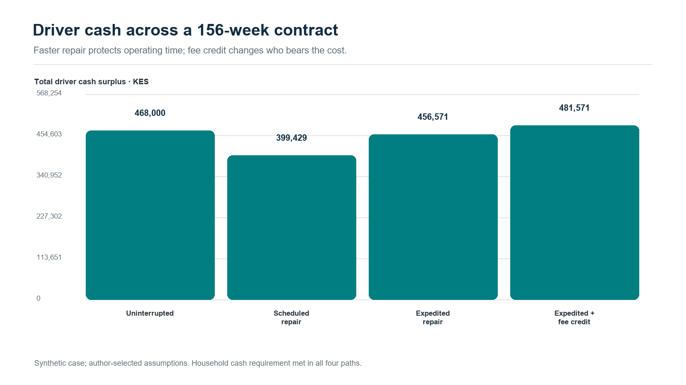
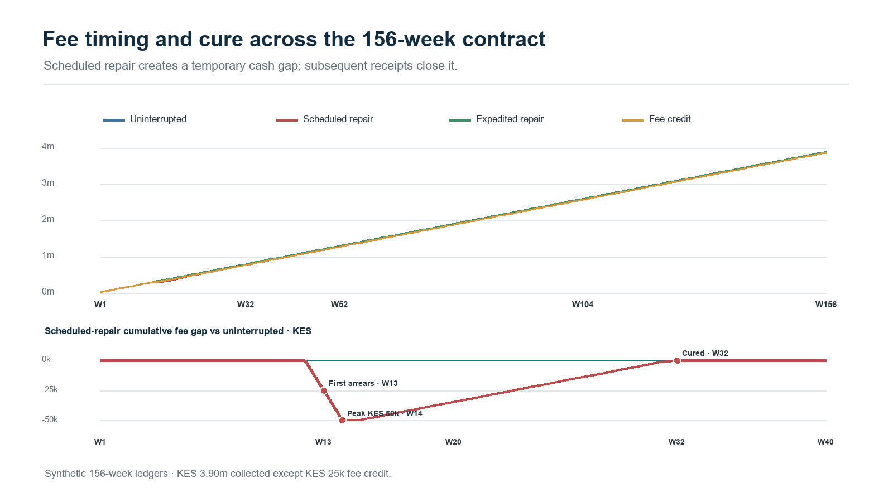
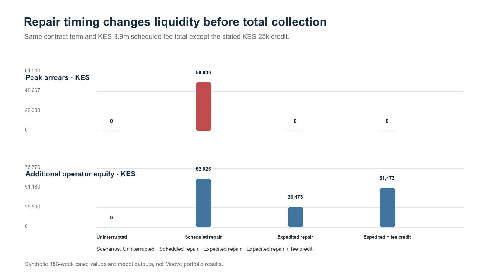
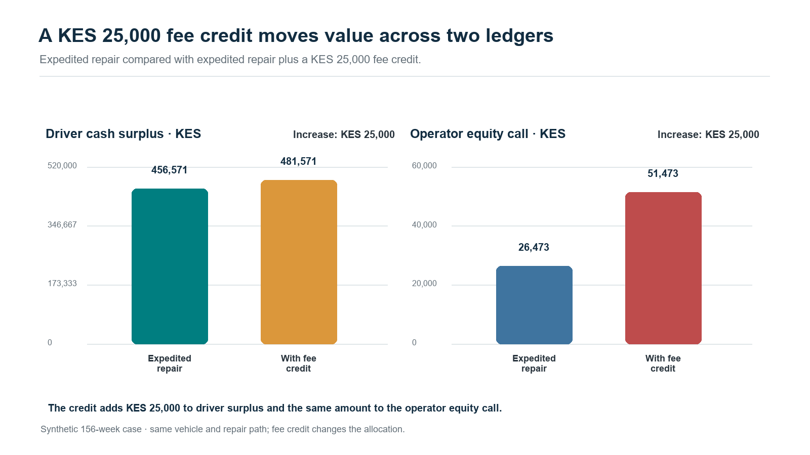

# Keeping mobility productive: connecting driver resilience, insurance and finance through Mwendo Pamoja

**Nevil Maloba | 13 October 2026**

<!-- ARTICLE_BODY_START -->

## The connection that brought the research into focus

A vehicle earns its keep through a chain of practical conditions. It needs a driver or an operating system, functioning components, appropriate insurance, energy, access to demand and a reliable route from completed work to settled cash. Financing depends on that chain continuing. This is the starting point of Mwendo Pamoja, my research into continuous underwriting and embedded finance for mobility. Reading CGAP’s 2023 study, *Putting Gig Data to Work*, helped me recognise a concrete commercial setting for the work: Moove and other businesses connecting vehicle access, productive operations and repayment. The connection gives the research a clear question about whose decisions can preserve value.

Malika Anand and Gayatri Murthy describe Moove using platform performance and telematics in vehicle financing, alongside support for drivers experiencing difficulty. Their account connects earnings, repayment, maintenance and insurance within an operating relationship [1]. That evidence motivated the application developed here. Moove’s current website presents capital, infrastructure and operations across driver-led and autonomous mobility [2]. My proposal builds on those publicly described activities through reproducible cash analysis, Bayesian uncertainty and measurable interventions. It is a proposed collaboration grounded in research and hypothetical cases. Three questions organise it: which information reveals a sustainable payment capacity; which support improves driver and financing outcomes; and how should the resulting cash and risk be allocated?

## Three questions to guide an applied partnership

**Research question one:** How can platform receipts, operating costs, household commitments, vehicle availability and insurance evidence jointly explain repayment capacity across the full vehicle agreement? The outcome would be an evolving assessment of what the driver can sustain, with uncertainty visible to a reviewer. **Research question two:** Which eligible intervention, delivered at which time, improves earning capacity, repayment and customer experience after allowing for its complete cost? **Research question three:** How can the same evidence support appropriate insurance pricing, operator profitability and financing of ring-fenced receivables? Together, these questions connect daily operations with the people and institutions carrying their financial consequences.

## Begin with the actual customer agreement

Moove’s UK Customer Hub describes fixed weekly payments leading to ownership, with insurance, servicing and other specified services included in its packages. It also describes telematics supporting claims [3]. That published arrangement provides a useful design discipline: reconstruct the actual package, payment schedule and responsibilities before adding a model. Mwendo’s original architecture includes separate premium finance, short operating loans and revolving facilities [4]. A mobility application selects the components relevant to its contract. Where insurance and repairs are already included, their costs belong in the package’s economics. A separately financed repair or premium creates an additional obligation only when a corresponding agreement establishes it.

## Follow cash from work to sustainable repayment

Daily fares provide the beginning of the analysis. Available repayment cash emerges after platform deductions, fuel or charging, maintenance requirements, other operating expenses and essential household commitments. Existing obligations and unrestricted savings also matter. Settlement timing can leave a productive driver short of cash on a payment date, while transfers from another account can temporarily improve the bank balance. The operating ledger should identify the source, owner and availability of each receipt. For a stated period, a simplified planning identity is:

Available repayment cash = settled operating receipts − operating cash costs − essential household needs − other obligations

Each term uses the same currency and period. Verified opening liquidity is recorded separately.

A sufficiency floor makes the analysis useful to servicing teams. It describes the operating and household cash required to sustain an agreed customer plan, using disclosed evidence and periodic review. The lender can compare a contractual payment with the cash available after those needs, including plausible downside scenarios. This supports an authorised payment adjustment, a repair assessment or a conversation about changing work conditions. The calculation preserves contractual debt, actual receipts and unmet needs as distinct records. A payment collected today becomes commercially stronger when the driver remains able to buy energy, maintain the vehicle and work tomorrow. This principle connects affordability directly to collection quality.

## Explain changes through time and operating states

The same missed payment can follow a delayed platform settlement, illness, a repair queue, reduced demand or a sustained operating deficit. These pathways suggest different responses. Mwendo’s temporal framework links the driver, vehicle, policy and facility at each decision time. A useful monitoring view distinguishes available for work, temporarily unavailable, awaiting repair, awaiting claim settlement, active with arrears, cured and contract completed. Product outcomes retain their own definitions and dates. Survival and competing-risk models can estimate when repayment, default, early settlement or another defined event occurs, while multi-state models allow a return from arrears to performance. Historical validation must reproduce what the reviewer actually knew then.

## Make uncertainty usable for decisions

Sparse experience is common when a fleet enters a market, introduces a vehicle model or finances a new driver cohort. Hierarchical Bayesian modelling pools evidence across relevant groups while preserving differences supported by observations. Mwendo’s credit model can organise driver episodes within geography, platform, product and time effects, with explicit priors governing the extent of pooling [4]. Classical actuarial credibility provides an established foundation for combining individual and collective experience [5]. The decision output includes a defined-horizon default estimate, a credible interval and the posterior probability that an approved risk threshold is exceeded. A reviewer can then distinguish an uncertain estimate from an established adverse pattern.

Computational feasibility is part of this design. Transparent liquidity features provide a baseline; sequence models become challengers whose additional contribution is tested out of time. Posterior updates and refreshed model versions can run within scheduled operating windows, with validated outputs served to case workers. A review screen should connect the interval to the decision under consideration: a new limit, revised payment schedule or additional evidence request. It should show uncertainty in future cash as well as uncertainty in the risk parameter. Thresholds, decision costs and permitted actions belong to the approved product policy. The reviewer receives evidence sufficiently structured to explain, amend and record a decision.

## Treat insurance as an operating dependency

Insurance connects protection, repair and vehicle availability. The proposed workflow records authoritative cover status, incident notification, claim acceptance, repair authorisation, completion and settlement as separate events. A covered repair may begin before the insurer reimburses the operator; the intervening cash requirement belongs to the party funding it. Excesses, exclusions, replacement transport and workshop capacity also affect the driver’s experience. Moove’s UK privacy policy describes vehicle and telematics data processing relevant to these relationships [6]. For an applied project, agreed interfaces would connect the insurer’s claim record to operational milestones and financial postings. That creates an observable route from an incident to restored earning capacity and settled obligations.

Bayesian Relativities supplies an insurance modelling component to this architecture [7]. It separates distance or another appropriate exposure measure, expected claim frequency and conditional claim severity. A simplified conditional calculation is:

Expected driving loss = driving exposure × claims per exposure unit × expected cost per claim

The calculation requires consistent coverage, valuation dates and units. Where frequency and severity share important drivers, a joint predictive model captures their dependence. Parked damage, theft and other losses receive suitable exposure definitions. Hierarchical credibility then supports individual indications and uncertainty. The insurer can use these outputs in approved pricing, reserving and risk-transfer decisions, while the operator receives quantities relevant to its actual retained costs and contracts.

The insurance interface also distinguishes an expected claims cost from a customer premium. Expenses, risk transfer, capital and commercial terms enter the insurer’s pricing process. A fleet can discuss renewal terms using exposure-adjusted evidence and claims maturity, while an approved reward programme can share demonstrated benefits with drivers. Portfolio normalisation preserves the selected expected-loss foundation when allocating relativities; a measured improvement in losses supports a separate reassessment of that foundation. This makes the actuarial contribution transparent during negotiations about who funds a reward and which party receives the improvement.

## Test the economics of restoring uptime

An existing Mwendo hypothetical case compares twelve days of downtime with an authorised KES 30,000 repair advance and an assumed two-day interruption. The longer interruption produces KES 10,749.86 of unpaid first-month contractual debt. Under the repair assumptions, that month’s scheduled payments are met [4]. This comparison makes the mechanism tangible: an earlier return to work can restore the cash supporting several obligations. The advance also raises the driver’s financing balance and subsequent charges. Both downtime durations are supplied scenario assumptions. Operational evidence would establish repair effectiveness, workshop capacity, customer acceptance and the subsequent repayment path, giving the illustration a measured business interpretation.

A complementary hypothetical case follows a bundled vehicle agreement for 156 weeks. The operator funds the covered repair, with KES 30,000 under twelve-day downtime and KES 35,000 under two-day downtime. Both scenarios ultimately collect KES 3.9 million. Faster repair increases the driver’s cumulative cash after household needs by approximately KES 57,143. Under the specified eighteen-percent discount rate, operator equity value falls by approximately KES 3,365 because the additional cost exceeds the timing benefit. This result focuses the commercial question: which measurable retention, operational or cost benefits could justify the intervention, and how could the parties share its benefits and funding requirements fairly?

*Figure 1. Driver cash surplus across four 156-week repair and fee paths.*

*Figure 2. Full-term fee collection and temporary arrears gap, derived from weekly case ledgers.*

*Figure 3. Peak arrears and additional operator equity by repair response.*

*Figure 4. A KES 25,000 fee credit increases driver cash surplus and operator equity calls by the same amount in this synthetic case.*

## Establish which intervention actually works

A repair, approved payment break, replacement vehicle, reserve release or coaching session can affect later earnings and repayment. Causal evaluation starts by specifying the eligible population, available actions, decision time and follow-up window. Random allocation among approved additional support options can establish a credible comparison while maintaining the standard service. Relevant outcomes include days available, driver cash after needs, arrears, durable cure, complaints and net collection after intervention costs. Observational analyses require explicit assumptions about treatment selection and measured confounders; longitudinal decisions also require attention to variables influenced by earlier support [8]. The evaluation should reflect the customer’s complete path through the intervention.

A contextual bandit becomes relevant when evidence supports choosing among approved actions using current circumstances. Its learning record includes action probabilities, eligibility, decision context and delayed outcomes. Sequential reinforcement learning addresses a further problem: today’s repair or adjustment can change tomorrow’s available actions and earning capacity. The initial implementation can remain a supervised decision-support pilot, with humans authorising material changes. A later sequential policy would require a validated simulator, appropriate off-policy evaluation and a defined operational envelope. This progression connects sophisticated methods to a specific business question: which sequence of support preserves durable customer and portfolio value within available resources?

## Carry the agreement through its full economic life

The full-horizon model follows scheduled payments, breaks, cure, early settlement, write-offs and recoveries alongside vehicle depreciation, replacement expenditure and ownership transfer. Maintenance costs may rise with age and mileage, while insurance prices and financing rates can change at different dates. At contractual completion, title and the associated residual economic benefit follow the agreement. A model that transfers ownership to the driver must allocate terminal vehicle value consistently. Early termination needs its own sale costs, condition assessment, recovery timing and contractual settlement. These details determine whether a product supports ownership economically and whether its early apparent margin survives the later years.

Profit testing brings those components together under base and stressed assumptions. The insurer’s view tracks premiums, claims development, expenses, reinsurance and required capital. The operator’s view tracks vehicle purchase, customer receipts, package costs, repairs, overhead and financing. The driver’s view tracks work receipts, living and operating needs, total payments and ownership outcomes. Each perspective receives a discounted cash-flow assessment and relevant downside measures. Multi-year actuarial analysis of capital and reinsurance illustrates why the sequence and durability of returns matter [9]. A mobility application adds its own contracts, tax, expenses and operating dynamics. Shared value becomes something the parties can calculate, examine and negotiate.

## Connect operations to ring-fenced receivables

Enterprise financing assesses the operator’s continuing business, assets and obligations. Financing ring-fenced receivables assesses identified contractual collections dedicated to repayment. The two analyses meet through the same customer cash, yet answer different funding questions. A proposed receivables structure tests eligibility, payment history, concentration, legal transfer, enforceability, account control and servicing continuity. An SPV is one possible vehicle for implementing that structure. The model then follows collection timing, funded reserves, senior costs, debt service and permitted residual distributions. It gives the funding team a way to examine how downtime or delayed remittance reaches liquidity and covenant calculations through explicit contracts.

Accounting ownership needs equal precision. A driver payment reduces the appropriate customer obligation when the contract recognises payment, while pending servicer remittance remains a separate exposure until cash arrives. An insurance receivable records an entitlement; its eventual settlement supplies liquidity. Reserve cash enters through a funded source and is replenished according to the agreed waterfall. A future repair advance needs a stated funder and an eligibility decision before entering a purchased pool. These distinctions make the actor ledger useful beyond reporting: it explains who pays now, who may recover later and whose balance sheet carries the intervening risk.

Portfolio stress should connect shocks that reach several accounts together. A flood can damage vehicles, interrupt demand, extend repair queues and delay collections. A platform disruption can affect many drivers simultaneously. The proposed tests therefore vary common demand, energy, repair and settlement conditions alongside individual events, then examine reserves and financing obligations. Concentration measures identify shared platforms, locations, vehicle models, insurers and workshops. Investors and operators can inspect how those dependencies change required liquidity and loss allocation, with scenario assumptions visible alongside the resulting cash distributions.

## Localise the model and build the evidence trail

Each market needs a configuration of currency, payment calendar, product terms, insurance coverage, consumer protections, data duties and funding conventions. Mwendo’s Kenyan KESONIA analysis supplies a specific pricing and funding context; an international vehicle programme uses the benchmark and contractual mechanics appropriate to its own obligations. FX exposures are identified where funding and collections differ in currency. A common analytical framework can therefore support local products while preserving their actual economics. Comparable outputs include collection timing, customer cash, contribution, coverage and liquidity, with a clear translation from local accounting and contractual definitions into the group’s reporting measures.

Data protection becomes a series of operating requirements. For a Kenyan implementation, the Data Protection Act provides the framework for lawful processing, purpose limitation, minimisation, security, impact assessment and rights concerning automated decisions [10]. The General Regulations develop requirements for automated individual decision-making, including meaningful information, appropriate procedures and human intervention [11]. The project should maintain a purpose and access register, retention schedules, processor agreements and approved transfer arrangements. Drivers need understandable communications and accessible review routes. Each deployment receives the jurisdictional assessment appropriate to its customer and data flows. Pseudonymised research identifiers allow useful analysis while controlling access to identifiable records.

Enterprise integration gives these requirements a practical home. A correlation identifier connects a case across platform events, servicing, insurer systems and finance. Event identifiers, effective dates, observation dates, model versions, approvals and execution receipts establish the individual steps. Product subledgers hold contractual detail; the general ledger receives reconciled postings. CRM records customer communication and review. Maker–checker controls govern specified amendments and payments. Teams can begin with secure extracts and reconciled files, then add APIs where the process benefits. A useful acceptance test asks whether an independent reviewer can reproduce a recommendation, see its uncertainty, identify its approver and reconcile the resulting cash.

Validation should connect mathematical checks to operating questions. Cash conservation tests reconcile opening balances, receipts, payments and closing balances for every actor. Contract schedules reconcile interest and principal; ownership events reconcile asset disposition. Predictive validation examines calibration, interval coverage and outcomes across credible groups and later periods. Data tests identify duplicate settlements, missing exposure and delayed claim updates. Human review examines whether explanations and recommended actions are useful in real cases. These checks become acceptance criteria shared by finance, operations, actuarial, engineering and customer teams.

## Adapt the framework to autonomous fleets

Waymo’s December 2024 partnership announcement describes Moove taking responsibility for fleet operations, facilities and charging infrastructure, with Waymo responsible for its driving system [12]. That division suggests a related application organised around vehicles, depots and service contracts. Availability, productive utilisation, charging queues, energy costs, maintenance capacity and contractual revenue become central model states. Human-driver household cash gives way to the relevant fleet operating obligations and service commitments. Insurance outcomes and counterparty risks also need their own definitions. The common contribution is a governed connection between operational decisions and financial consequences, with a simulator and evidence base calibrated to autonomous fleet operations.

## Start with one decision that a partner can evaluate

A practical partnership could begin with one market, one vehicle product and one repair-support decision. An initial discovery stage would reconcile contract terms, identify decision owners and map available event and claim records. Historical reconstruction would establish baseline cash, uptime and collection measures. Shadow recommendations would then test data quality, explanations and staff workflow. A controlled pilot would compare approved support options over a pre-specified outcome window, with sample size determined by the effect and precision required. A final decision pack would present driver outcomes, incremental operator contribution, insurer implications and financing effects, including uncertainty and the resources needed for expansion.

A joint pilot scorecard would record both the average effect and the spread of outcomes. Improvement criteria would be agreed before results emerge, including acceptable customer outcomes, implementation cost, operational capacity and the precision needed for a decision. The next investment could then follow a documented gate: expand the pilot, revise the intervention, improve the evidence or retain the existing process. Each route produces reusable knowledge for the next product and market development decision.

The same proposal can serve vehicle subscription businesses, lease-to-own operators, delivery fleets and mobility lenders whose economics depend on productive assets and recurring collections. Each partner would select its own contracts, intervention and commercial objective. For Moove, the public operating model provides a particularly relevant setting for discussion. CGAP’s study helped bring that connection into focus. Mwendo Pamoja supplies a research architecture for pursuing it: follow the operating cash, preserve decision ownership, estimate uncertainty, evaluate support and reconcile the resulting value. The invitation is concrete: choose a decision, reconstruct its economics and test whether a better intervention improves the outcomes that each participant depends on.

<!-- ARTICLE_BODY_END -->

## References

[1] M. Anand and G. Murthy, “Putting Gig Data to Work: Innovations in Expanding Credit Access,” CGAP Brief, Jun. 2023. [Online]. Available: https://documents1.worldbank.org/curated/en/099063023143011873/pdf/P17436207747210ff096970c02a59ed1daf.pdf

[2] Moove, “Moove: The Future of Mobility.” Accessed: Oct. 13, 2026. [Online]. Available: https://www.moove.io/

[3] Moove, “Customer Hub,” United Kingdom. Accessed: Oct. 13, 2026. [Online]. Available: https://uk.moove.io/customer-hub/

[4] N. Maloba, *Mwendo Pamoja: Continuous Underwriting*, research manuscripts and reproducible operating and financing case, 2026. [Online]. Available: https://github.com/TheAlchemistNerd/mwendo-pamoja-continuous-underwriting

[5] H. Bühlmann, “Experience Rating and Credibility,” *ASTIN Bulletin*, vol. 4, no. 3, pp. 199–207, 1967, doi: 10.1017/S0515036100008989. [Online]. Available: https://www.cambridge.org/core/journals/astin-bulletin-journal-of-the-iaa/article/experience-rating-and-credibility/B9A879CE4A73397C653963B474A7F954

[6] Moove, “Privacy Policy,” United Kingdom. Accessed: Oct. 13, 2026. [Online]. Available: https://uk.moove.io/privacy-policy/

[7] N. Maloba, *Bayesian Credibility and Exposure-Normalised Telematics Relativities*, research paper, 2026. [Online]. Available: https://github.com/TheAlchemistNerd/bayesian-telematics-relativities

[8] M. A. Hernán and J. M. Robins, *Causal Inference: What If*. Boca Raton, FL, USA: Chapman & Hall/CRC, 2020, updated online edition. [Online]. Available: https://miguelhernan.org/whatifbook

[9] I. Robbin and A. Malhotra, “Modeling the Impact of Capital Management and Reinsurance on Long-Term Profitability,” *CAS Forum*, Summer 2023. [Online]. Available: https://forum.casact.org/article/83958-modeling-the-impact-of-capital-management-and-reinsurance-on-long-term-profitability

[10] Republic of Kenya, *Data Protection Act*, No. 24 of 2019, especially ss. 25, 26, 29–31, 35, 41–43 and 48–49. [Online]. Available: https://new.kenyalaw.org/akn/ke/act/2019/24/eng%402019-11-15/source

[11] Republic of Kenya, *Data Protection (General) Regulations*, Legal Notice No. 263 of 2021, especially reg. 22. [Online]. Available: https://www.odpc.go.ke/wp-content/uploads/2024/03/THE-DATA-PROTECTION-GENERAL-REGULATIONS-2021-1.pdf

[12] Waymo, “Next stop: Miami,” Dec. 5, 2024. [Online]. Available: https://waymo.com/blog/2024/12/next-stop-miami/

## Publication record

Main article word count: **3,000 words**. See the companion verification file for the counting method. Licensed under the Creative Commons Attribution-NonCommercial-ShareAlike 4.0 International licence (CC BY-NC-SA 4.0): https://creativecommons.org/licenses/by-nc-sa/4.0/.
